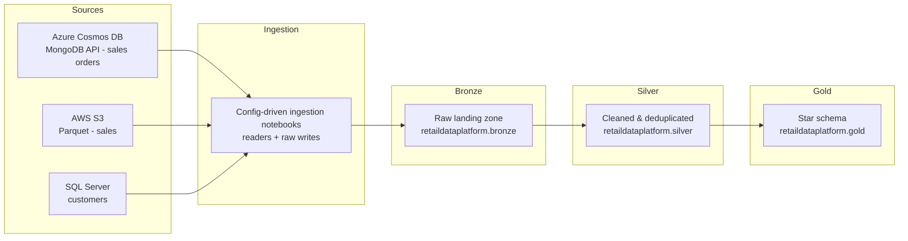
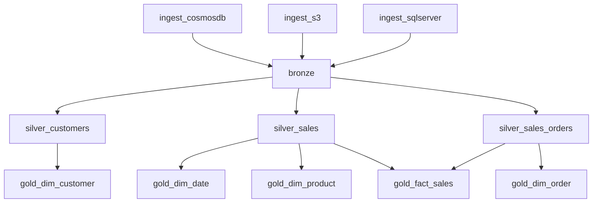

# 🛒 Retail Data Platform

An end-to-end **lakehouse data platform on Databricks** that ingests retail data from three heterogeneous sources — **Azure Cosmos DB, AWS S3, and SQL Server** — through a **medallion architecture (Bronze → Silver → Gold)** and serves an analyst-ready **star schema** (`fact_sales` + conformed dimensions) in **Unity Catalog**.

The entire pipeline is **orchestrated as a single scheduled Lakeflow Job**, defined as code with a **Declarative Automation Bundle**, and every notebook is **config-driven** — no hardcoded connections, no hardcoded credentials.

---

## 🏗️ Architecture



## 🔄 Pipeline Orchestration

`resources/job.yml` defines the job `Pl_E2E_Retail_Data_Platform`:

* Runs daily (05:00 Europe/London), with **automatic retries**, **queueing**, and **failure email alerts**
* Fan-in / fan-out task dependencies:



## ✨ Design Highlights

* **Config-driven everything** — each ingestion and transformation notebook reads a JSON config (source, target, select/cast columns, modes), so adding a source is a new config file, not new code.
* **Shared `common_utils` library** — reusable logging, multi-source ingestion readers (`read_cosmosdb_json`, `read_s3_parquet`, `read_sqlserver`), SCD Type-1 Delta `MERGE`, and generic transforms like safe column casting.
* **Secrets-based credential management** — all connection strings and cloud keys are fetched at runtime from **Databricks Secret Scopes**; nothing sensitive lives in the repo.
* **Idempotent, re-runnable loads** — data lands partitioned by `load_date`, and silver loads use SCD Type-1 MERGE, so re-runs never duplicate data.
* **Gold star schema** — `fact_sales` built by joining three silver tables, with `dim_customer`, `dim_date`, `dim_product`, and `dim_order` dimensions.
* **Data quality handling** — deduplication of order data, null-safe key generation (e.g. product IDs with SHA-256 fallback), and safe casting to prevent silent nulls/crashes.
* **Everything as code** — the job is deployed via a Databricks Declarative Automation Bundle (`databricks.yml` + `resources/job.yml`).

## 📊 Data Model (Gold)

| Table | Grain | Built from |
| --- | --- | --- |
| `fact_sales` | one row per order line | silver sales, sales_orders, order_products, promotions |
| `dim_customer` | one row per customer | silver customers |
| `dim_product` | one row per product | silver sales |
| `dim_date` | one row per day (generated) | silver sales order dates |
| `dim_order` | one row per order | silver sales_orders |

## 📁 Repository Structure

```text
retail_data_platform/
├── databricks.yml              # DABs bundle definition
├── resources/
│   └── job.yml                  # E2E Lakeflow Job (schedule, DAG, retries)
├── common_utils/               # shared Python library
│   ├── ingester.py             #   multi-source readers + raw writers
│   ├── scdfunctions.py         #   SCD Type-1 Delta MERGE helpers
│   ├── generic_functions.py    #   safe casts & transformations
│   └── logging.py               #   centralized logging
├── src/
│   ├── ingestion/              # source → raw JSON/Parquet on cloud storage
│   ├── bronze/                 # raw → bronze Delta tables (UC)
│   ├── silver/                 # bronze → cleaned, deduplicated, typed tables
│   └── gold/                   # silver → star schema (facts & dimensions)
├── docs/
│   └── DATA-PRODUCT-BLUEPRINT.md
└── test/
```

## 🧰 Tech Stack

| Area | Tools |
| --- | --- |
| Platform | Databricks (serverless), Unity Catalog |
| Processing | PySpark, Delta Lake |
| Sources | Azure Cosmos DB (MongoDB API), AWS S3, SQL Server |
| Orchestration | Lakeflow Jobs + Declarative Automation Bundles |
| Language & tooling | Python, JSON-driven config, Git |
| Security | Databricks Secret Scopes |

## 🚀 Getting Started

1. **Prerequisites** — a Databricks workspace with Unity Catalog, and access to the three source systems (Cosmos DB, S3, SQL Server).
2. **Create the secret scope** — add connection strings and cloud keys to a Databricks secret scope (e.g. `retail-platform-dev`):

   ```bash
   databricks secrets create-scope <scope-name>
   databricks secrets put-secret <scope-name> <key-name>
   ```

3. **Point the configs at your sources** — edit the JSON files under `src/*/config/` (source connection keys, target paths, table names).
4. **Deploy and run the job**:

   ```bash
   databricks bundle deploy --target dev
   databricks bundle run Pl_E2E_Retail_Data_Platform
   ```

## 🔭 Possible Next Steps

* Streaming (Auto Loader) ingestion for near-real-time sales orders
* Data-quality expectations with row-level metrics on silver tables
* AI/BI dashboards on top of the gold star schema
* CI/CD with automated `bundle validate`/`deploy` on pull requests
